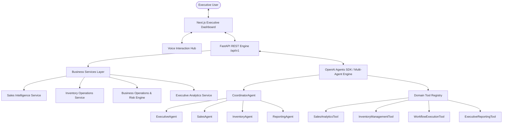

# Milestone 7 — Business Operations Platform Architecture

## Overview
Operator One has been transformed into an **Enterprise Voice AI Business Operations Manager**. The architecture unites real-time voice streaming, multi-agent collaboration, domain business tools, and executive dashboard metrics into a modular, production-grade platform.

---

## Technical Stack & Architecture

---

## Core System Layers

### 1. Frontend Command Hub (`frontend/src/app`)
- **Executive Overview**: High-level KPIs (MRR, ARR, Active Pipeline, Inventory Score, Operational Readiness).
- **Sales Intelligence**: Real-time deals table, stage probability scoring, and total pipeline valuation.
- **Inventory Operations**: Stock level monitoring, low-stock warnings, and one-click reorder triggers.
- **Workflow Monitoring**: Active business workflows, progress indicators, and manual trigger controls.
- **Voice Command HUD**: Docked voice control interface supporting natural speech commands.

### 2. Multi-Agent Collaboration Engine (`backend/app/agent`)
- **CoordinatorAgent**: Routes user intent to appropriate domain tool.
- **Domain Tools**: Registered with `@register_tool` and validated via Pydantic input/output schemas.

### 3. Business Operations Services (`backend/app/services`)
- **SalesService**: Manages sales deals and pipeline summaries.
- **InventoryService**: Tracks warehouse stock and calculates health scores.
- **BusinessOpsService**: Aggregates executive summaries and live operational risk alerts.
- **AnalyticsService**: Provides executive analytics and recommendations.
