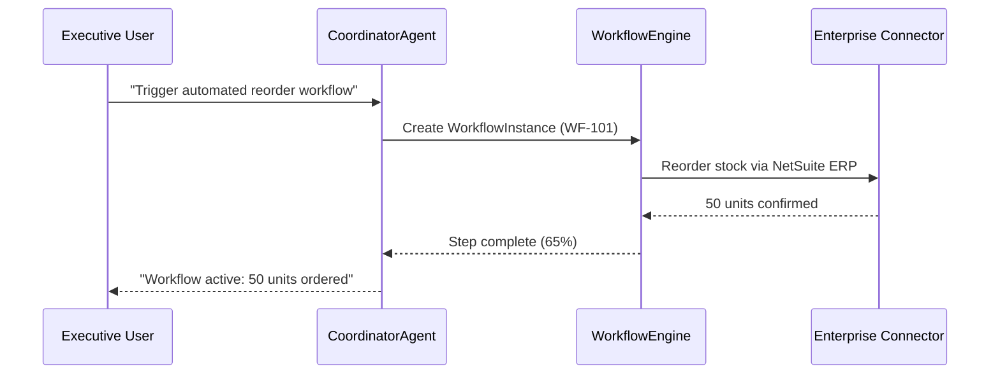

# Business Process Automation Engine Specification

## Overview
Operator One's **Business Process Automation Engine** enables cross-system multi-step workflow execution, scheduled cron jobs, conditional execution paths, and human-in-the-loop sign-off gates.

## Workflow Execution Flow

## Supported Workflows
- **Automated Inventory Reorder**: Triggered when stock drops below threshold.
- **Deal Stagnation Engagement**: Triggers AI proposal refresh for inactive leads >4 days.
- **Compliance & Asset Audit Sign-off**: Requires human-in-the-loop executive approval gate.
