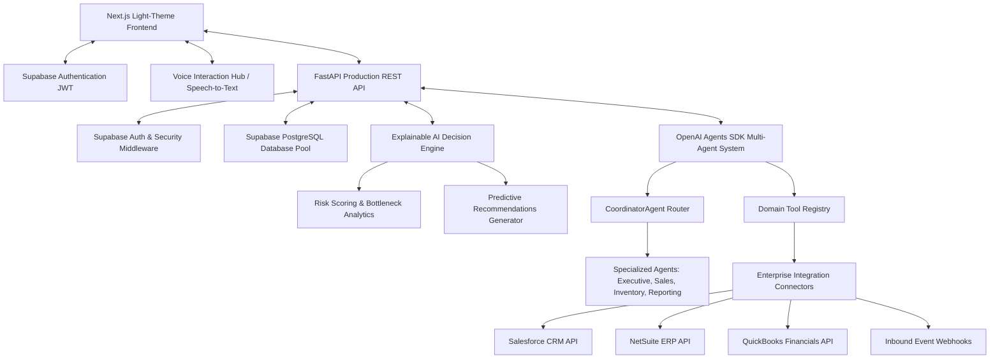

# Operator One — Full System Architecture Blueprint

## Executive Overview
**Operator One** is a commercially deployable, production-grade **Voice-First Enterprise AI Business Operations Platform**. It combines real-time speech processing, OpenAI Agents SDK multi-agent orchestration, explainable AI risk scoring, standardized enterprise system connectors, and an executive Next.js command dashboard.

---

## Architectural Diagram

---

## Technical Stack Summary

| Layer | Technologies | Key Responsibilities |
| :--- | :--- | :--- |
| **Frontend** | Next.js 14, React 18, Tailwind CSS (Light Theme + Purple Accent), TypeScript | Executive Command Hub, Dashboard Widgets, Voice Bar, Auth Modal, Integrations & Risk Hub |
| **Backend** | FastAPI, Python 3.11, Pydantic v2, Uvicorn | Production REST API, CORS security, Exception handling, Auth middleware, Logging |
| **Auth & Database** | Supabase Auth (JWT), Supabase PostgreSQL, SQLAlchemy | User identity, session persistence, normalized database schemas, pool management |
| **AI Orchestration** | OpenAI Agents SDK, Python Multi-Agent Framework | Intent analysis, autonomous planning, tool registry, multi-agent collaboration |
| **Integrations** | `BaseConnector` Abstraction (Salesforce, NetSuite, QuickBooks, Webhooks) | Cross-system data synchronization, health testing, inbound webhook processing |
| **Decision Engine** | Explainable Risk Engine (`backend/app/engine/`) | Live operational risk index (0-100), bottleneck detection, predictive recommendations |
